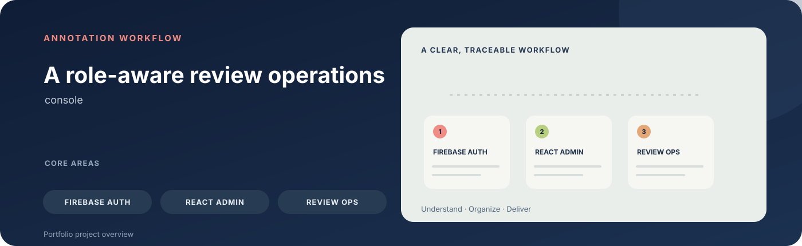

# Annotation Workflow Console



A React Admin console for annotation and quality-review work. It covers user, post, todo, audit-log and settings views, with Firebase email-and-password sign-in and role lookup through a PHP API backed by MongoDB and MySQL.

> **Team project.** This was built with other students. See [My contribution](#my-contribution) for the parts I wrote.

## Main areas

- **User administration**: browse and manage user records.
- **Annotation and review content**: create and edit post records and their assignment fields.
- **Image and video tools**: editor and restore views for annotated media (`src/backend/*Editor.tsx`, `*Restore.tsx`).
- **Workflow support**: todo lists and audit history.
- **Role-aware access**: admin, site-builder and expert-reviewer roles.

## My contribution

I built the **image and video annotation editors** that reviewers use on todo items, the **restore views** that show the saved annotations, and the **overlay API** behind them:

- **Image editor** ([`src/backend/ImageEditor.tsx`](src/backend/ImageEditor.tsx)): draws freehand pen marks over the image on a Konva canvas, with an eraser, a clear button and a remark field. It saves the marks and remark to the API (`POST /backend/api/overlay/imagesave`).
- **Video editor** ([`src/backend/VideoEditor.tsx`](src/backend/VideoEditor.tsx)): the same drawing tools on a canvas layered over the video player. Each mark records the video time at which it was drawn, and the result is saved through `POST /backend/api/overlay/videosave`.
- **Image restore view** ([`src/backend/ImageRestore.tsx`](src/backend/ImageRestore.tsx)): loads a post's saved marks and remark (`GET /backend/api/overlay/fetchimage`) and draws them back over the image on the posts page.
- **Video restore view** ([`src/backend/VideoRestore.tsx`](src/backend/VideoRestore.tsx)): loads the saved video marks (`GET /backend/api/overlay/fetchvideo`) and shows each one as playback reaches the time it was drawn.
- **Overlay API** ([`OverLayDataController.php`](src/backend/src/controllers/OverLayDataController.php), [`OverLayData.php`](src/backend/src/models/OverLayData.php) and the `overlay/*` routes in [`api.php`](src/backend/src/routes/api.php)): PHP endpoints that store image and video annotations (mark coordinates, video time, remark, reviewer and media link per post) in a MySQL `overlay_data` table using PDO prepared statements, and return them for the restore views.

Built with React, TypeScript, react-konva, Material UI, PHP and MySQL. The rest of the application was built by other team members.

## Project structure

```
src/                 React Admin frontend (TypeScript, Vite)
  authProvider.tsx   Firebase sign-in and role lookup
  users.tsx, posts.tsx, todos.tsx, logs.tsx, settings.tsx
src/backend/         PHP API (Apache, Composer)
  public/index.php   entry point
  src/routes/api.php routes under /backend/api/...
  src/controllers/   request handlers
  src/models/        MongoDB / MySQL data access
  .env.example       configuration template
DataSimple/          sample JSON data for testing
Dockerfile, docker-compose.yml   PHP + Apache container with MongoDB extension
```

## Getting started

### 1. Backend configuration

Copy the template and fill in your own database details:

```sh
cp src/backend/.env.example src/backend/.env
```

The real `.env` file is ignored by Git. Never commit it.

### 2. Run the backend

The repository includes a PHP 8.1 + Apache Dockerfile with the MongoDB extension. Before using Compose, change the Windows-specific `volumes` path in `docker-compose.yml` to your own checkout path, then run:

```sh
docker compose up --build
```

The API is then served on `http://localhost:8098/backend/api/`.

### 3. Run the frontend

```sh
npm install
npm run dev
```

Other scripts: `npm run type-check`, `npm run build`, `npm run serve`.

### Firebase

Sign-in uses Firebase Authentication. The web config in `src/authProvider.tsx` and `src/FirebaseAuth.js` points to the original project. To run your own copy, create a Firebase project and replace those values.

### Maintenance script

`addUserIdToUsers.js` is a one-off script that adds IDs to existing user records. It reads the connection string from the environment:

```sh
MONGODB_URL="<your connection string>" node addUserIdToUsers.js
```

## Known issues

Open bugs are tracked in [`Bugs.txt`](Bugs.txt), for example assignment updates on posts not saving the `assignedTo` field.

## Technology

**React Admin** · **TypeScript** · **React** · **Vite** · **Firebase Authentication** · **PHP** · **MongoDB** · **MySQL** · **Docker**
